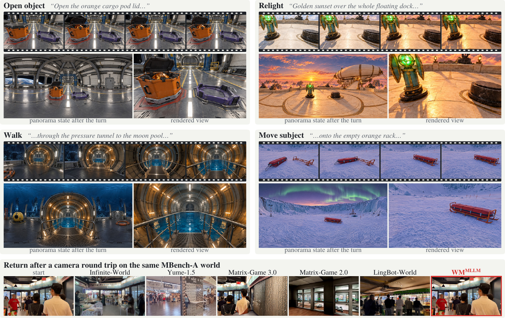
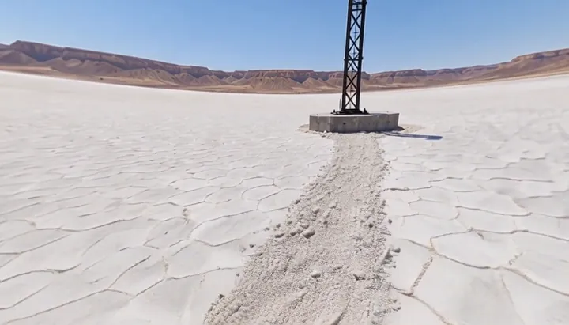
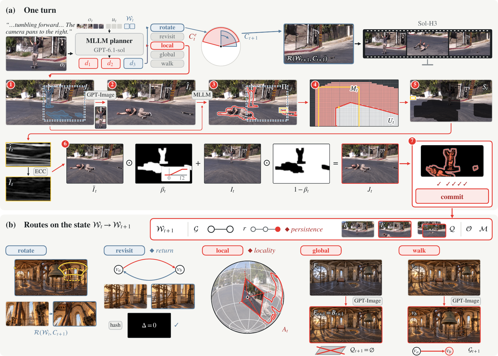

<div align="center">

<h1>WM<sup>MLLM</sup>: Turning MLLMs into World Models</h1>

Baiang&nbsp;Li<sup>1,3</sup> &nbsp;·&nbsp; Enze&nbsp;Xie<sup>2,&dagger;</sup> &nbsp;·&nbsp; Jincheng&nbsp;Yu<sup>2</sup> &nbsp;·&nbsp; Jin&nbsp;Wang<sup>2</sup> &nbsp;·&nbsp; Haozhe&nbsp;Liu<sup>2</sup> &nbsp;·&nbsp; Yitong&nbsp;Li<sup>2</sup> &nbsp;·&nbsp; Juanxi&nbsp;Tian<sup>3</sup> &nbsp;·&nbsp; Felix&nbsp;Heide<sup>1</sup>

<sup>1</sup>Princeton&nbsp;University &emsp; <sup>2</sup>NVIDIA &emsp; <sup>3</sup>OpenEnvision<br><sup>&dagger;</sup>Project Lead

<a href="https://baiangli.com/assets/files/wm_mllm_tr.pdf"></a> <a href="https://baiangli.com/wmmllm/"></a> <a href="https://github.com/ztMotaLee/WM_mllm/releases/tag/v0.1.1"></a> <a href="LICENSE"></a>

<!-- TODO(arXiv): after the identifier is assigned, add this badge, and add eprint and archivePrefix to the BibTeX entry below and to CITATION.cff:
<a href="https://arxiv.org/abs/XXXX.XXXXX"></a>
-->

</div>

<p align="center">
  
</p>
<p align="center"><em>WM<sup>MLLM</sup> opens objects, relights scenes, walks to new places and moves subjects; each panel shows one turn: video frames, the panorama state and the rendered view. After one camera round trip, five baselines end on different scenes and WM<sup>MLLM</sup> on the starting view (mean pixel difference between the first and last frame, 0–255: 88.4 to 101.3 against 1.1).</em></p>

**WM<sup>MLLM</sup> is the first interactive world model built on multimodal large language models (MLLMs), for persistent, editable world generation from a single image.**

Video world models keep the world in the context of a generator, so a revisit is synthesized again and earlier edits can drift or disappear. WM<sup>MLLM</sup> keeps the world state outside every generator, as a panorama with a revision history, and lets the MLLMs write it: they turn each request into operations on this state, select where a local edit is written, and check every candidate before it becomes the next state. Image generators only propose views, and video only presents them. Users can walk to new places and return, edit objects through text or a box, place subjects, and change lighting, weather or season. By construction, a revisit at the same revision reproduces the earlier view exactly, a local edit leaves every panorama pixel outside its region unchanged, and each request starts from the result of the previous one.

## News

- **2026-11-18:** Code release [v0.1.1](https://github.com/ztMotaLee/WM_mllm/releases/tag/v0.1.1): the minimal implementation; you supply the API endpoint, key and models.
- **2026-11:** The [technical report](https://baiangli.com/assets/files/wm_mllm_tr.pdf) is released.
- **2026-11-13:** Code release [v0.1.0](https://github.com/ztMotaLee/WM_mllm/releases/tag/v0.1.0).

## Highlights

- **MBench-A.** Against six world model baselines, WM<sup>MLLM</sup> has the highest mean on all four environment-recovery metrics (Epipolar 91.5 versus 0.1 to 74.0). It completes 191 of the 224 camera round trips (85.3%). The six baselines complete 0.4% to 50.9%.
- **CompBench.** WM<sup>MLLM</sup> has the best value in all 15 CompBench columns (five metrics on three editing tasks) against 15 baselines.
- **Support after generation.** On 112 local edits judged blind, selecting the region to write after generation raises completion from 34.8% to 83.0%.
- **State properties.** On 258 WBench and MBench-A items, all 46 revisits recover their earlier views. All 97 local edits that pass the check leave panorama pixels outside their region unchanged.
- **Long sessions.** Over 21 sequential requests in one world, the state keeps every earlier change. Requests 1–20 change pixels only inside one box that covers 10.7% of the panorama. Request 21 relights the whole panorama.

## Gallery

<table>
  <tr>
    <td width="59%" valign="top"></td>
    <td width="41%" valign="top"></td>
  </tr>
  <tr>
    <td valign="top"><b>A long session at a lagoon pier.</b> Saved states, one fixed crop.</td>
    <td valign="top"><b>One local edit of that session.</b> <i>"Bloom the broad hibiscus shrub with large coral-red flowers above the raft chest."</i></td>
  </tr>
</table>

<table>
  <tr>
    <td width="50%" valign="top"></td>
    <td width="50%" valign="top"></td>
  </tr>
  <tr>
    <td valign="top"><b>Four worlds, four kinds of request.</b> Walking to a new place, weather, a local edit and light.</td>
    <td valign="top"><b>A state at rest.</b> The page plays it as a loop. A loop writes nothing to the state.</td>
  </tr>
</table>

In the lagoon pier session, each request builds on the state that the previous request committed. The last request relights the whole panorama. The bloom clip presents the transition. The next request starts from the state that the commit installs.

The media are selected system outputs, trimmed, cropped and scaled for display. The loop is a crop of a panorama band clip from the project page. In the lagoon pier session, candidates that failed the checks were generated again, so it does not measure success at the first attempt. The teaser uses earlier example sessions for three of its four worlds. Those sessions include repairs made before release, so they do not measure success at the first attempt. Transition videos come from Sol-H3, which this release does not include. More worlds are on the [project page](https://baiangli.com/wmmllm/).

## Method

<p align="center">
  
</p>
<p align="center"><em>WM<sup>MLLM</sup> overview. Pretrained models read the explicit state, and only commits that pass the checks write it.</em></p>

WM<sup>MLLM</sup> stores each scene as a panorama with local patches and a revision history. A deterministic renderer produces its views. GPT-6.1-sol plans operations, selects the support of local edits, checks candidates and records observations. GPT-Image proposes endpoint images, and Sol-H3 generates transition videos. The state after each turn becomes the source of the next turn, and these update rules give three properties:

- **Return.** Rotation renders the current revision at a new orientation and calls no image or video generator. A revisit that completes with the same physical revision, view identity, camera and rendering profile reproduces the earlier image pixel for pixel.
- **Locality.** A GPT-6.1-sol selector compares the source view with the proposal and returns the support of a local edit. The executor aborts the operation if any panorama pixel outside the support changes.
- **Persistence.** A candidate that fails is retried once on the same route. Commit installs the panorama revision, camera, endpoint and facts as the source for the next request, so proposals that fail and video frames never enter memory.

Presentation never writes the state. The [architecture notes](docs/ARCHITECTURE.md) map these components to modules and describe turn and commit semantics.

## Results

**MBench-A environment recovery and camera return.** Means on 224 common items, scored with one evaluator version. [Table 3 of the technical report](https://baiangli.com/assets/files/wm_mllm_tr.pdf#page=11) adds 95% bootstrap intervals, camera motion and blind frame judgments; one baseline has higher camera motion.

| Method | Epipolar ↑ | Reprojection ↑ | Lighting ↑ | Style ↑ | Pose return [%] ↑ |
| --- | ---: | ---: | ---: | ---: | ---: |
| HY-WorldPlay | 74.0 | 75.6 | 98.6 | 97.9 | 50.9 |
| Infinite-World | 59.5 | 60.9 | 94.8 | 96.2 | 25.0 |
| Matrix-Game 3.0 | 47.5 | 53.8 | 94.4 | 93.5 | 0.9 |
| Yume-1.5 | 18.9 | 21.3 | 90.5 | 91.5 | 20.5 |
| Matrix-Game 2.0 | 0.7 | 1.3 | 85.6 | 74.1 | 1.8 |
| LingBot-World | 0.1 | 2.1 | 89.6 | 85.1 | 0.4 |
| **WM<sup>MLLM</sup>** | **91.5** | **92.2** | **99.4** | **99.3** | **85.3** |

**CompBench local editing (n = 2,465).** Baseline scores are those that CompBench reports. Direct editing keeps the whole GPT-Image proposal. The rows include five of the 15 baselines, with the strongest one of every column. [Table 4 of the technical report](https://baiangli.com/assets/files/wm_mllm_tr.pdf#page=12) adds the multi-object and implicit-reasoning panels.

| Method | LC-T ↑ | LC-I ↑ | PSNR ↑ | SSIM ↑ | LPIPS ↓ |
| --- | ---: | ---: | ---: | ---: | ---: |
| GoT | 20.268 | 0.807 | 24.675 | 0.889 | 0.067 |
| Step1X-Edit | 20.495 | 0.817 | 23.372 | 0.882 | 0.078 |
| BAGEL | 21.059 | 0.838 | 27.692 | 0.935 | 0.045 |
| FLUX.1 Kontext | 21.328 | 0.821 | 25.613 | 0.941 | 0.050 |
| Qwen-Image-Edit | 21.522 | 0.828 | 24.968 | 0.892 | 0.072 |
| Direct editing | 21.729 | 0.832 | 26.760 | 0.898 | 0.064 |
| **WM<sup>MLLM</sup>** | **21.910** | **0.845** | **30.440** | **0.964** | **0.025** |

<details>
<summary><b>Blind evaluation of composition</b> (<a href="https://baiangli.com/assets/files/wm_mllm_tr.pdf#page=13">Figure 7 of the technical report</a>)</summary>

<br>

Keeping the whole proposal completes the most instructions, and support selected after generation most often completes the edit without other changes. Values are percentages of cases. CompBench groups and subtasks are weighted equally. The benchmark run uses the first proposals of the 112 local edits.

| Population | Composition | Instruction completed | Completed without other changes |
| --- | --- | ---: | ---: |
| CompBench, 150 proposals | Direct editing | 91.3 | 30.0 |
| | Threshold paste | 60.6 | 22.0 |
| | WM<sup>MLLM</sup> | 86.6 | **52.6** |
| Benchmark run, 112 local edits | Direct editing | 86.6 | 10.7 |
| | Support before generation | 34.8 | 16.1 |
| | Support after generation (WM<sup>MLLM</sup>) | 83.0 | **49.1** |

</details>

## What this release contains

This release contains the session engine used for the paper's multi-turn sessions, API providers, CPU panorama geometry, observed semantic memory, revision-aware saved views, and the code that scores the paper's saved outputs. Procedural examples use explicitly labeled deterministic providers. They test software behavior and do not measure model quality.

The video generation model and its runtime are not included. Eligible rotations and revisits are rendered on CPU; other transitions have no generated video, which plugs in through the `VideoBackend` interface. Model weights, datasets and paper outputs are not included.


## Install

Use Linux or a compatible POSIX system with Python 3.10 or later. CPU clips require `ffmpeg` on PATH. GPU and model packages are unnecessary for core installation.

```bash
git clone https://github.com/ztMotaLee/WM_mllm.git
cd WM_mllm
python -m venv .venv
. .venv/bin/activate
python -m pip install .
```

Install `'.[dev]'` to run tests. The wheel contains the `wmmllm` package and its prompt resources. Evaluation runs from the source checkout; see [evaluation](docs/EVALUATION.md).

## Use your own API

> [!IMPORTANT]
> This repository provides no API key, account, endpoint or default model. You fill every `WMM_*` value yourself, including the base URL of your own provider, and you pay your provider for the requests.

```bash
cp .env.example .env
# Fill the WMM_* values in your own .env file.
wmmllm check-config --env-file .env
```

Keys come only from the process environment or `--env-file`. The program never searches for an env file. Do not put keys in YAML or command-line arguments. `WMM_LLM_BASE_URL` and the model names are required and have no built-in default. Set both `WMM_LLM_MODEL` and `WMM_IMAGE_MODEL` for distinct chat and image models. An empty image field inherits the corresponding chat field.

The paper's multi-turn sessions and MBench-A recovery runs used GPT-6.1-sol with reasoning effort **high** for all chat roles and GPT-Image 2.5 through the image edit endpoint. Some diagnostic segments used other reasoning efforts; see [evaluation](docs/EVALUATION.md). The 21-request conservatory session in the Highlights ran GPT-6.1-sol at reasoning effort xhigh with GPT-Image 2.5. The historical CompBench proposals used GPT-Image 2. Other models may behave differently. Your endpoint must support the selected models, ordered multimodal inputs, strict JSON schemas, reasoning controls and multi-image editing. Endpoint compatibility and live model quality require separate verification.

Chat requests use the Chat Completions endpoint. See every key, precedence rule and spend cap in [configuration](docs/CONFIGURATION.md).

Without configuration, `wmmllm check-config` exits with code 2 before constructing a client:

```text
Missing WMM_LLM_API_KEY for chat provider; set the process environment or an explicitly selected env file; no request was sent.
```

## Quickstart

First run the offline procedural example from this source checkout:

```bash
python -B examples/offline_session/run.py --run offline-run
wmmllm view --run offline-run --yaw 0 --pitch 0 --out offline-view.png
```

Use new output directories. The example performs initialization, rotation, a drawn local edit and a revisit with real engine geometry, memory and transactions. It makes no model calls. Its providers do not implement navigation; separate core tests exercise navigation with queued test responses. `wmmllm view` renders the current state without credentials.

For a real session, supply your own initial image and configured API:

```bash
wmmllm init --image room.png --run my-run --title "My room" --env-file .env
wmmllm step --run my-run --env-file .env 'Look right by 45 degrees.'
wmmllm step --run my-run --env-file .env 'Put a blue bowl on the table.'
wmmllm session --run my-run --script turns.json --env-file .env
```

Each real command may incur provider charges. Supply an explicit env file again on later commands. Configure prices and a spend cap before running if needed. `session` resumes a session and executes an array of instruction strings or an object with a `turns` array. Each array entry may also be an object with an `instruction` string.

If initialization fails, retry its saved checkpoint with `wmmllm resume --run my-run --env-file .env`. Use the same configuration. A labeled `BOOTSTRAP_HOLD` keeps the original image and leaves the world uninitialized, with no panorama or memory facts; `resume` can retry it. Repeating `init` also requires the same image pixels, captions, seed, panorama width and runtime settings. Changed initialization inputs are rejected. Each retry keeps prior attempt files intact.

## Evaluation

The [evaluation guide](docs/EVALUATION.md) covers MBench environment scoring, saved-pose camera analysis and CompBench, and maps each paper result to its code. Obtain datasets, saved outputs, benchmark code and weights separately. CPU tests require no downloads:

```bash
python -m pytest -q
```

## Limitations

Historical recovery, pooled diagnostics, multi-turn sessions and CompBench used distinct configurations. Fresh generation is stochastic. Paper numbers are reproduced by scoring the original outputs, rather than by bit-identical regeneration. Original outputs and video generation are not distributed here.

The current session engine uses one full session configuration. Historical recovery profiles, study arms and independent judge pipelines are absent. Cross-origin revisits have no clip. External API access, model availability and new model behavior are user-specific. The dependency ranges are not a full transitive reproduction lock. See [architecture](docs/ARCHITECTURE.md) for state and transaction behavior. Section 5 of the [technical report](https://baiangli.com/assets/files/wm_mllm_tr.pdf) lists the limitations of the method.

## License

Original code and procedural assets use [Apache-2.0](LICENSE); see [NOTICE](NOTICE). The evaluation adapters load MBench and CompBench from checkouts you obtain; their code is not included. Model weights, datasets and user outputs are governed by their own terms.

## Citation

```bibtex
@misc{li2026wmmllm,
  title        = {{WM$^{\mathrm{MLLM}}$}: Turning {MLLMs} into World Models},
  author       = {Li, Baiang and Xie, Enze and Yu, Jincheng and Wang, Jin and Liu, Haozhe and Li, Yitong and Tian, Juanxi and Heide, Felix},
  year         = {2026},
  howpublished = {\url{https://baiangli.com/wmmllm/}},
  note         = {Technical report}
}
```
