<div align="center">

<h1>WM<sup>MLLM</sup>: Turning MLLMs into World Models</h1>

Baiang&nbsp;Li<sup>1,3</sup> · Enze&nbsp;Xie<sup>2,&dagger;</sup> · Jincheng&nbsp;Yu<sup>2</sup> · Jin&nbsp;Wang<sup>2</sup> · Haozhe&nbsp;Liu<sup>2</sup> · Yitong&nbsp;Li<sup>2</sup> · Juanxi&nbsp;Tian<sup>3</sup> · Felix&nbsp;Heide<sup>1</sup>

<sup>1</sup>Princeton&nbsp;University &emsp; <sup>2</sup>NVIDIA &emsp; <sup>3</sup>OpenEnvision<br><sup>&dagger;</sup>Project Lead

<a href="https://ztmotalee.github.io/wmmllm/#play"></a> <a href="https://ztmotalee.github.io/wmmllm/"></a> <a href="https://arxiv.org/pdf/2611.24193"></a> <a href="https://github.com/ztMotaLee/WM_mllm/releases/tag/v0.1.1"></a> <a href="LICENSE"></a>

<a href="#one-state-three-requests">Requests</a> &nbsp;·&nbsp; <a href="#worlds">Worlds</a> &nbsp;·&nbsp; <a href="#one-world-twenty-requests">Long session</a> &nbsp;·&nbsp; <a href="#results">Results</a> &nbsp;·&nbsp; <a href="#how-it-works">How it works</a> &nbsp;·&nbsp; <a href="#run-it-yourself">Run it yourself</a> &nbsp;·&nbsp; <a href="#citation">Citation</a>

</div>

<p align="center">
  <a href="https://ztmotalee.github.io/wmmllm/">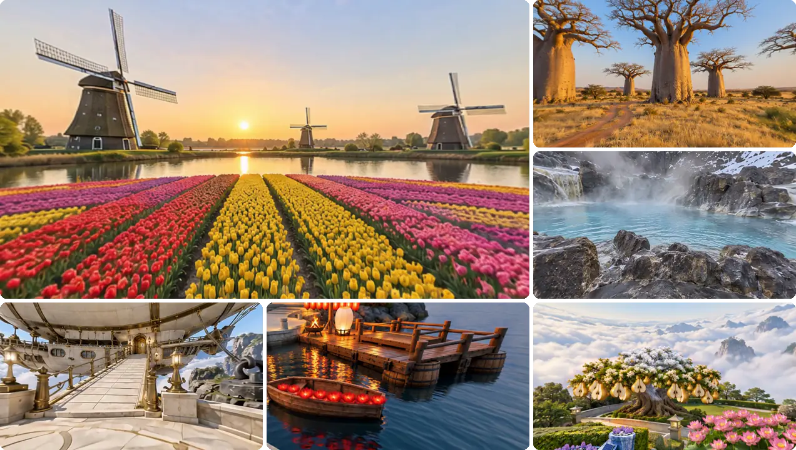</a>
</p>
<p align="center"><sub><b>Six requests in six worlds.</b> Each tile is the Sol-H3 transition clip of one request, trimmed and cropped; clockwise from the large tile: a red sunset, a thunderstorm, snow on a hot spring, frost on a tree, lanterns set afloat and a walk up a boarding ramp.</sub></p>

**WM<sup>MLLM</sup> is the first interactive world model built on multimodal large language models (MLLMs), for persistent, editable world generation from a single image.** Video world models keep the world in the context of a generator, so a revisit is synthesized again and earlier edits can drift or disappear. WM<sup>MLLM</sup> keeps the world state outside every generator, as a panorama with a revision history, and lets the MLLMs write it: they turn each request into operations on this state, select where a local edit is written, and check every candidate before it becomes the next state. Image generators only propose views, and video only presents them. By construction, a revisit at the same revision reproduces the earlier view exactly, a local edit leaves every panorama pixel outside its region unchanged, and each request starts from the result of the previous one.

<table>
  <tr>
    <td width="50%" align="center" valign="top"><h3>85.3%</h3><sub>of 224 camera round trips on MBench-A completed; the six baselines complete 0.4% to 50.9%</sub></td>
    <td width="50%" align="center" valign="top"><h3>91.5</h3><sub>MBench-A Epipolar mean for environment recovery; the six baselines reach 0.1 to 74.0</sub></td>
  </tr>
  <tr>
    <td align="center" valign="top"><h3>15 / 15</h3><sub>CompBench columns with the best value, against 15 baselines</sub></td>
    <td align="center" valign="top"><h3>83.0%</h3><sub>completion of 112 local edits, judged blind by Claude Opus 5.5, with the region selected after generation; 34.8% when selected before</sub></td>
  </tr>
</table>

## News

- **2026-11-18:** Code release [v0.1.1](https://github.com/ztMotaLee/WM_mllm/releases/tag/v0.1.1): the minimal implementation; you supply the API endpoint, key and models.
- **2026-11-13:** Code release [v0.1.0](https://github.com/ztMotaLee/WM_mllm/releases/tag/v0.1.0).
- **2026-11:** The [technical report](https://arxiv.org/pdf/2611.24193) is released.

## One state, three requests

Click **Play** to replay a request in the browser.

<p align="center">
  <a href="https://ztmotalee.github.io/wmmllm/#play=world19&state=S0">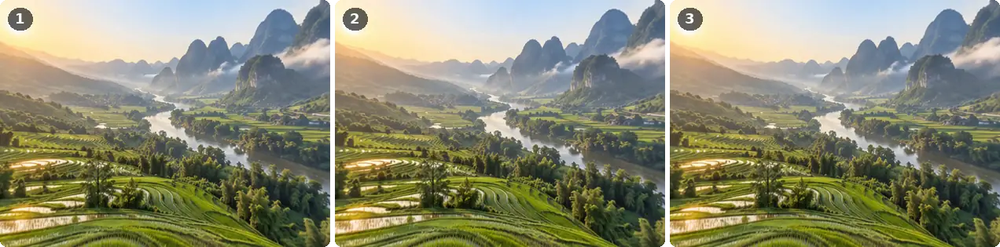</a>
</p>
<p align="center"><sub><b>One saved state, three requests.</b> Sol-H3 transition clips of three requests in Rice Terrace Valley, each from the same saved panorama state, played side by side.</sub></p>

1. *"Change the whole valley to harvest time, with every terrace in ripe golden rice."* [Play&nbsp;↗](https://ztmotalee.github.io/wmmllm/#play=world19&state=S0&action=harvest)
2. *"Fill the whole valley with a sea of white morning mist below the platform."* [Play&nbsp;↗](https://ztmotalee.github.io/wmmllm/#play=world19&state=S0&action=mist)
3. *"Turn the morning into a clear starry night over the whole valley."* [Play&nbsp;↗](https://ztmotalee.github.io/wmmllm/#play=world19&state=S0&action=night)

## Worlds

Click a tile to open its world in the project page's play mode. The page plays saved panorama states and their clips; nothing is generated while you browse.

<p align="center">
  <a href="https://ztmotalee.github.io/wmmllm/#play=world16&state=lake00">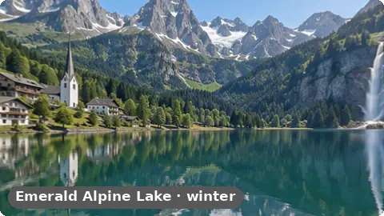</a> <a href="https://ztmotalee.github.io/wmmllm/#play=world04&state=A1&action=A1_A2">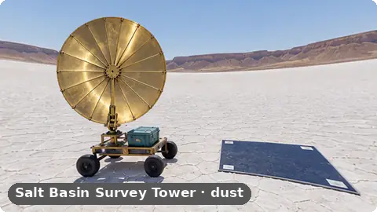</a> <a href="https://ztmotalee.github.io/wmmllm/#play=world05&state=chasm00">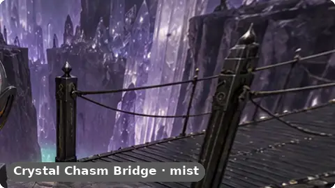</a><br>
  <a href="https://ztmotalee.github.io/wmmllm/#play=world13&state=harbor05&action=step06"></a> <a href="https://ztmotalee.github.io/wmmllm/#play=world16&state=lake11&action=step12">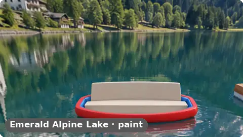</a> <a href="https://ztmotalee.github.io/wmmllm/#play=world14&state=terrace12&action=step13">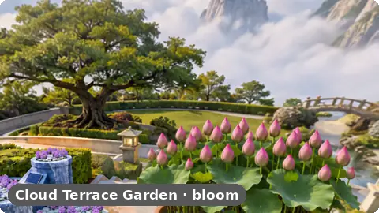</a><br>
  <a href="https://ztmotalee.github.io/wmmllm/#play=world15&state=caldera16&action=step17">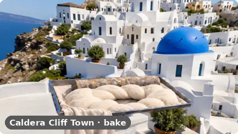</a> <a href="https://ztmotalee.github.io/wmmllm/#play=world22&state=torii13&action=step14"></a> <a href="https://ztmotalee.github.io/wmmllm/#play=world05&state=chasm00">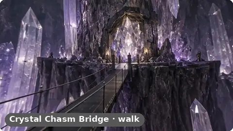</a>
</p>

<p align="center"><sub><b>Nine requests in seven worlds.</b> Each tile is the Sol-H3 transition clip of one request, trimmed, cropped and scaled: the top row changes the whole world, the next five tiles edit objects in place, and the last tile walks.</sub></p>

<details>
<summary><b>The request in each tile</b></summary>

1. **Emerald Alpine Lake.** *"Change the whole valley to deep winter, with the lake frozen and snow on the village, the forest and the peaks."*
2. **Salt Basin Survey Tower.** *"Bring a low ochre dust front across the salt basin under soft saffron light."* [Play&nbsp;↗](https://ztmotalee.github.io/wmmllm/#play=world04&state=A1&action=A1_A2)
3. **Crystal Chasm Bridge.** *"Fill the fissure below the bridge with glowing jade mist and keep the bridge deck clear."*
4. **Lantern Harbor.** *"Light the eight hanging red lantern candles from the burning bowl on the raft deck."* [Play&nbsp;↗](https://ztmotalee.github.io/wmmllm/#play=world13&state=harbor05&action=step06)
5. **Emerald Alpine Lake.** *"Paint the dinghy hull, rigid flotation collar, bench and backrest bright yellow."* [Play&nbsp;↗](https://ztmotalee.github.io/wmmllm/#play=world16&state=lake11&action=step12)
6. **Cloud Terrace Garden.** *"Open the closed lotus buds into large layered pink flowers above the broad green leaves."* [Play&nbsp;↗](https://ztmotalee.github.io/wmmllm/#play=world14&state=terrace12&action=step13)
7. **Caldera Cliff Town.** *"Bake the braided dough wreath into swollen golden bread with deep crust splits, retaining its open ring shape."* [Play&nbsp;↗](https://ztmotalee.github.io/wmmllm/#play=world15&state=caldera16&action=step17)
8. **Sunrise Torii Lake.** *"Unfold the lantern's two broad rear wings sideways above the punt, keeping its open front shutters and supported foot fixed."* [Play&nbsp;↗](https://ztmotalee.github.io/wmmllm/#play=world22&state=torii13&action=step14)
9. **Crystal Chasm Bridge.** *"Cross the suspension bridge to the crystal alcove."*

The clips of tiles 1, 3 and 9 are on the project page outside its play data, so these tiles open the world at its start.

</details>

<details>
<summary><b>Nine more worlds</b> (one saved state of each)</summary>
<br>
<p align="center">
  <a href="https://ztmotalee.github.io/wmmllm/#play=world12&state=oasis00">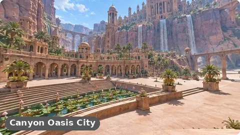</a> <a href="https://ztmotalee.github.io/wmmllm/#play=world20&state=iceberg00"></a> <a href="https://ztmotalee.github.io/wmmllm/#play=world23&state=abbey00">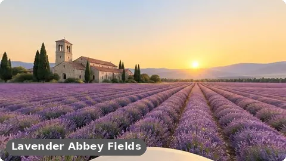</a><br>
  <a href="https://ztmotalee.github.io/wmmllm/#play=world09&state=clock00">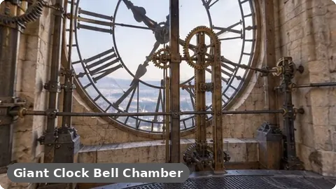</a> <a href="https://ztmotalee.github.io/wmmllm/#play=world08&state=foundry00">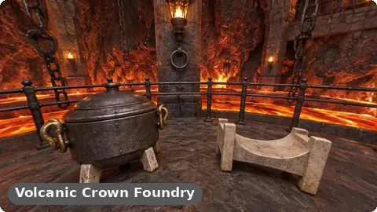</a> <a href="https://ztmotalee.github.io/wmmllm/#play=world01&state=dome00">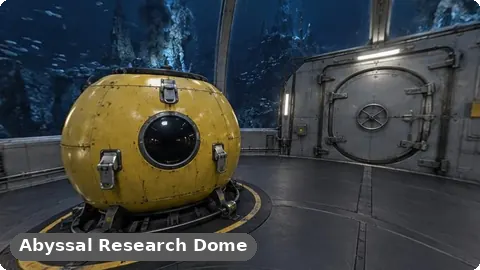</a><br>
  <a href="https://ztmotalee.github.io/wmmllm/#play=world03&state=bay00">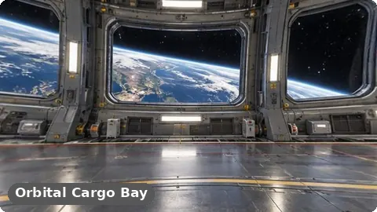</a> <a href="https://ztmotalee.github.io/wmmllm/#play=world02&state=crater00">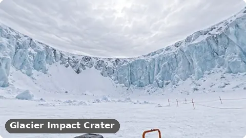</a> <a href="https://ztmotalee.github.io/wmmllm/#play=world06&state=roof00">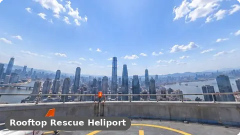</a>
</p>

</details>

## One world, twenty requests

In Lagoon Pier Island, a raft garden grows over 20 sequential requests. Each request builds on the state that the previous request committed. [Play this session ↗](https://ztmotalee.github.io/wmmllm/#play=world17&state=pier00)

<p align="center">
  <a href="https://ztmotalee.github.io/wmmllm/#play=world17&state=pier08&action=step09"></a>
</p>
<p align="center"><sub><b>Requests 9, 10, 11 and 13, then request 20.</b> Sol-H3 transition clips in session order, joined by hard cuts; request 20 relights the whole panorama.</sub></p>

<p align="center">
  <a href="https://ztmotalee.github.io/wmmllm/#play=world17&state=pier20"></a>
</p>
<p align="center"><sub><b>The state after request 20, all the way around.</b> A 360° turn rendered from the saved panorama by the renderer in this release; rotation calls no image or video generator.</sub></p>

<details>
<summary><b>All 21 saved states and the 20 requests</b> (each request links to its clip in play mode)</summary>
<br>
<p align="center">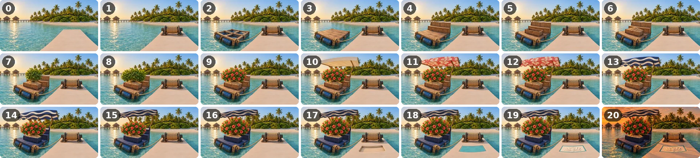</p>
<p align="center"><sub><b>All 21 saved states.</b> The start (0) and the panorama after each of the 20 requests, in the same crop, left to right and top to bottom.</sub></p>

1. [Install one broad rope-wound mooring windlass on the pier-end stone.](https://ztmotalee.github.io/wmmllm/#play=world17&state=pier00&action=step01)
2. [Build one compact barrel-supported raft hull moored to the pier windlass on the near water.](https://ztmotalee.github.io/wmmllm/#play=world17&state=pier01&action=step02)
3. [Deck the barrel-supported raft hull with one broad timber panel beside the pier.](https://ztmotalee.github.io/wmmllm/#play=world17&state=pier02&action=step03)
4. [Place one broad closed-base timber bench with an integral tall paneled back across the rear raft deck.](https://ztmotalee.github.io/wmmllm/#play=world17&state=pier03&action=step04)
5. [Build one broad empty shallow timber chest with low feet and a pouring lip on the raft deck before the seat.](https://ztmotalee.github.io/wmmllm/#play=world17&state=pier04&action=step05)
6. [Fill the shallow raft chest with carried wet sand, heaping a broad mound above its rim.](https://ztmotalee.github.io/wmmllm/#play=world17&state=pier05&action=step06)
7. [Plant one compact chest-width unflowered hibiscus shrub in the sand mound of the raft chest.](https://ztmotalee.github.io/wmmllm/#play=world17&state=pier06&action=step07)
8. [Grow two dense lateral foliage fans from the hibiscus, keeping its current height and its stems rooted in the chest sand.](https://ztmotalee.github.io/wmmllm/#play=world17&state=pier07&action=step08)
9. [Bloom the broad hibiscus shrub with large coral-red flowers above the raft chest.](https://ztmotalee.github.io/wmmllm/#play=world17&state=pier08&action=step09)
10. [Fit one broad cream cantilever canvas awning with integral brackets to the raft bench back above the flowering chest.](https://ztmotalee.github.io/wmmllm/#play=world17&state=pier09&action=step10)
11. [Paint the cream raft awning coral with broad ivory hibiscus silhouettes.](https://ztmotalee.github.io/wmmllm/#play=world17&state=pier10&action=step11)
12. [Extend the awning’s coral front valance into a broad scalloped canvas shade above the raft flowers.](https://ztmotalee.github.io/wmmllm/#play=world17&state=pier11&action=step12)
13. [Paint the awning canvas and scalloped valance indigo with broad ivory wave bands.](https://ztmotalee.github.io/wmmllm/#play=world17&state=pier12&action=step13)
14. [Stain the exposed timber raft deck, chest exterior and bench deep indigo.](https://ztmotalee.github.io/wmmllm/#play=world17&state=pier13&action=step14)
15. [Gather the awning canvas and scalloped valance upward into broad accordion pleats along the existing canopy rails.](https://ztmotalee.github.io/wmmllm/#play=world17&state=pier14&action=step15)
16. [Grow the hibiscus broadly upward into the space opened beneath the folded canopy, with its woody stems rooted in the same sand mound.](https://ztmotalee.github.io/wmmllm/#play=world17&state=pier15&action=step16)
17. [Carve one wide shallow rectangular recess in the clear pier stone in front of the windlass, half the pier's width.](https://ztmotalee.github.io/wmmllm/#play=world17&state=pier16&action=step17)
18. [Inlay one thick turquoise ceramic panel flush inside the carved pier recess in front of the windlass.](https://ztmotalee.github.io/wmmllm/#play=world17&state=pier17&action=step18)
19. [Inlay a broad solid ivory ceramic plaque bearing a shallow lotus relief flush inside the turquoise pier panel, leaving a narrow turquoise rim.](https://ztmotalee.github.io/wmmllm/#play=world17&state=pier18&action=step19)
20. [Deepen the lagoon garden into warm sunset around the raft and pier.](https://ztmotalee.github.io/wmmllm/#play=world17&state=pier19&action=step20)

</details>

> [!NOTE]
> The media on this page are outputs of WM<sup>MLLM</sup> and, in the return grid, of the baselines. They are chosen by hand and trimmed, cropped and scaled for display; badges, boxes, outlines and the orange map are drawn on top, and joins between clips are hard cuts. The example worlds start from a panorama that GPT-Image generates from text; the benchmark items start from a single image. In the long sessions, an agent wrote each request from the current state, and candidates that failed the checks were generated again, so the media do not measure success at the first attempt. Sol-H3 made the transition videos and is not part of this release; the 360° turn is rendered on CPU from a saved state.

## Results

### Return to the same view

<p align="center">
  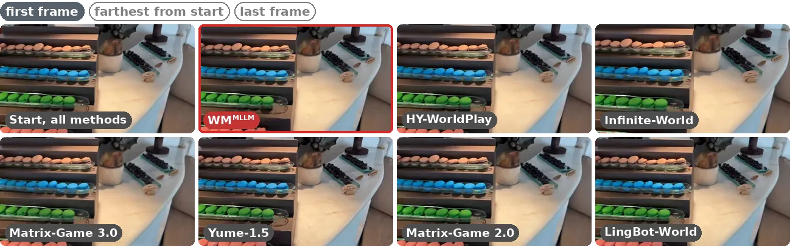
</p>
<p align="center"><sub><b>One camera round trip on MBench-A.</b> Every method starts from the same image, turns away and is asked to return.</sub></p>
<p align="center"><sub>Top row: the first frame, which all methods share; WM<sup>MLLM</sup>; HY‑WorldPlay; Infinite‑World. Bottom row: Matrix‑Game 3.0, Yume‑1.5, Matrix‑Game 2.0, LingBot‑World.</sub></p>

In this round trip, Infinite‑World and Yume‑1.5 bring the camera back to about 8.2° and 4.9° from the start and still show a different counter. A round trip is complete when the camera first turns in the requested direction, reaches at least 15° in that direction and ends within 10° of the start ([scorer](eval/camera/README.md)). Over all 224 common items, WM<sup>MLLM</sup> completes 191 round trips (85.3%) and has the highest mean on all four environment-recovery metrics. Between outbound and return frames matched by pose, its median LPIPS is 0.037, against 0.32 to 0.65 for the six baselines. In the benchmark run (158 WBench and 100 MBench-A items, separate from these 224 round trips), all 46 revisits match their panorama state and arrival view hashes.

| Method | Epipolar&nbsp;↑ | Reprojection&nbsp;↑ | Lighting&nbsp;↑ | Style&nbsp;↑ | Pose return [%]&nbsp;↑ |
| --- | ---: | ---: | ---: | ---: | ---: |
| HY‑WorldPlay | 74.0 | 75.6 | 98.6 | 97.9 | 50.9 |
| Infinite‑World | 59.5 | 60.9 | 94.8 | 96.2 | 25.0 |
| Matrix‑Game&nbsp;3.0 | 47.5 | 53.8 | 94.4 | 93.5 | 0.9 |
| Yume‑1.5 | 18.9 | 21.3 | 90.5 | 91.5 | 20.5 |
| Matrix‑Game&nbsp;2.0 | 0.7 | 1.3 | 85.6 | 74.1 | 1.8 |
| LingBot‑World | 0.1 | 2.1 | 89.6 | 85.1 | 0.4 |
| **WM<sup>MLLM</sup>** | **91.5** | **92.2** | **99.4** | **99.3** | **85.3** |

<sub><b>MBench-A environment recovery and camera return.</b> Means on 224 common items, scored with one evaluator version. [Table 3 of the technical report](https://arxiv.org/pdf/2611.24193#page=11) adds 95% bootstrap intervals, camera motion and blind frame judgments by Claude Opus 5.5; one baseline has higher camera motion.</sub>

### Edits stay local

<p align="center">
  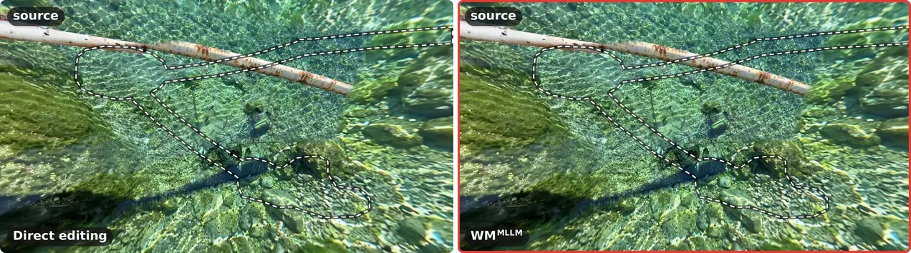
</p>
<p align="center"><sub><b>One proposal, two ways to apply it.</b> One MBench-A request, applied by direct editing (left) and by WM<sup>MLLM</sup> (right). Each panel shows the source, the result and a map. Orange marks each pixel outside the region (outlined in dashes) whose largest channel change exceeds 16 of 255 levels, measured on web copies of the frames in Figure 5 of the technical report.</sub></p>

The request adds a fishing rod that drags debris along a riverbed. Direct editing keeps the whole GPT-Image proposal, which also adds a rock that the request does not ask for. Outside the region, direct editing changes 54% of the pixels and threshold paste 25% by more than 16 intensity levels; WM<sup>MLLM</sup> changes none. In the benchmark run, 97 of the 112 local edits pass the check, and all 97 leave every panorama pixel outside their region unchanged. Selecting the region after generation raises completion on 112 local edits judged blind from 34.8% to 83.0%.

<details>
<summary><b>CompBench local editing and blind evaluation of composition</b> (Table 4 and Figure 7 of the technical report)</summary>

<br>

**CompBench local editing (n = 2,465).** Baseline scores are those that CompBench reports. Direct editing keeps the whole GPT-Image proposal. The rows include five of the 15 baselines, with the strongest one of every column. [Table 4 of the technical report](https://arxiv.org/pdf/2611.24193#page=12) adds the multi-object and implicit-reasoning panels.

| Method | LC-T ↑ | LC-I ↑ | PSNR ↑ | SSIM ↑ | LPIPS ↓ |
| --- | ---: | ---: | ---: | ---: | ---: |
| GoT | 20.268 | 0.807 | 24.675 | 0.889 | 0.067 |
| Step1X-Edit | 20.495 | 0.817 | 23.372 | 0.882 | 0.078 |
| BAGEL | 21.059 | 0.838 | 27.692 | 0.935 | 0.045 |
| FLUX.1&nbsp;Kontext | 21.328 | 0.821 | 25.613 | 0.941 | 0.050 |
| Qwen-Image-Edit | 21.522 | 0.828 | 24.968 | 0.892 | 0.072 |
| Direct editing | 21.729 | 0.832 | 26.760 | 0.898 | 0.064 |
| **WM<sup>MLLM</sup>** | **21.910** | **0.845** | **30.440** | **0.964** | **0.025** |

**Blind evaluation of composition** ([Figure 7](https://arxiv.org/pdf/2611.24193#page=13)). Keeping the whole proposal completes the most instructions, and support selected after generation most often completes the edit without other changes. Claude Opus 5.5 judges the outputs blind to the method, in random order. The judge has no human calibration. Values are percentages of cases. CompBench groups and subtasks are weighted equally. The benchmark run uses the first proposals of the 112 local edits.

| Population | Composition | Instruction completed | Completed without other changes |
| --- | --- | ---: | ---: |
| CompBench, 150 proposals | Direct editing | **91.3** | 30.0 |
| | Threshold paste | 60.6 | 22.0 |
| | WM<sup>MLLM</sup> | 86.6 | **52.6** |
| Benchmark run, 112 local edits | Direct editing | **86.6** | 10.7 |
| | Support before generation | 34.8 | 16.1 |
| | Support after generation (WM<sup>MLLM</sup>) | 83.0 | **49.1** |

</details>

### Earlier edits stay

<p align="center">
  <a href="https://ztmotalee.github.io/wmmllm/#play=world11&state=A0">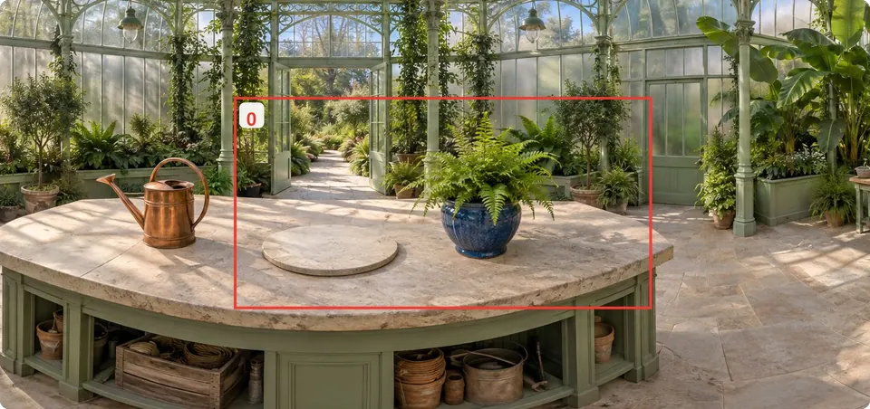</a>
</p>
<p align="center"><sub><b>The state keeps every earlier change.</b> Saved panorama states of the conservatory session in the same crop: requests 1–20 change pixels only inside the red box, which covers 10.7% of the panorama, and request 21 relights the whole panorama.</sub></p>

Without the revision in the view lookup, 60 of the 198 lookups of the benchmark run (30.3%) would return a view from before a later edit, and each of them passes the hash checks. [Figure 8 of the technical report](https://arxiv.org/pdf/2611.24193#page=13) shows this session; [play it ↗](https://ztmotalee.github.io/wmmllm/#play=world11&state=A0).

## How it works

<p align="center">
  <picture>
    <source media="(prefers-color-scheme: dark)" srcset="assets/readme/method_where_dark.webp">
    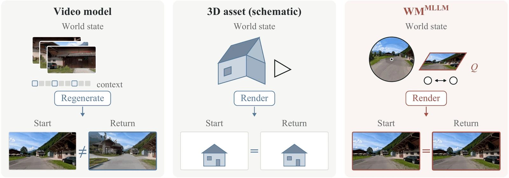
  </picture>
</p>
<p align="center"><sub><b>Where the world lives.</b> A video model generates a revisit again from its context, a 3D-asset system renders an explicit scene (schematic), and WM<sup>MLLM</sup> renders a revisit from its panorama state.</sub></p>

WM<sup>MLLM</sup> stores each scene as a panorama with local patches and a revision history, and a deterministic renderer produces its views. In each turn, GPT-6.1-sol plans operations on the state, GPT-Image proposes the endpoint image of an edit, the MLLM selects the region to write and checks the candidate, and the commit installs the new revision. Sol-H3 then presents the transition as a video. Presentation never writes the state.

The five routes, each with an example request in play mode:

- **rotate** · No generator. [Drag the view in play mode ↗](https://ztmotalee.github.io/wmmllm/#play=world17&state=pier20)
- **revisit** · Reuses a saved view when its revision, camera and rendering profile match and the hashes agree. No generator. [*"Restore the saved golden sunrise fields."*](https://ztmotalee.github.io/wmmllm/#play=world21&state=G1&action=sunset_restore)
- **local** · Writes a GPT-Image proposal into the panorama, only inside the region that the MLLM selects. [*"Paint the wooden harvest box deep lavender purple."*](https://ztmotalee.github.io/wmmllm/#play=world23&state=abbey10&action=step11)
- **global** · A change of lighting, weather or season replaces the panorama and retires earlier patches. [*"Fill the whole fields with low white morning mist that lies between the rows."*](https://ztmotalee.github.io/wmmllm/#play=world21&state=S0&action=mist)
- **walk** · Generates the destination panorama for a new place. [*"Walk along the white gravel strip to the base of the black tower."*](https://ztmotalee.github.io/wmmllm/#play=world04&state=A0&action=A0_B0)

These update rules give three properties:

- **Return.** Rotation renders the current revision at a new orientation and calls no image or video generator. A revisit that completes with the same physical revision, view identity, camera and rendering profile reproduces the earlier image pixel for pixel.
- **Locality.** A GPT-6.1-sol selector compares the source view with the proposal and returns the support of a local edit. The executor aborts the operation if any panorama pixel outside the support changes.
- **Persistence.** A candidate that fails is retried once on the same route. Commit installs the panorama revision, camera, endpoint and facts as the source for the next request, so proposals that fail and video frames never enter memory.

<details>
<summary><b>Full method figure</b> (Figure 2 of the technical report)</summary>
<br>
<p align="center">
  <picture>
    <source media="(prefers-color-scheme: dark)" srcset="assets/readme/method_dark.webp">
    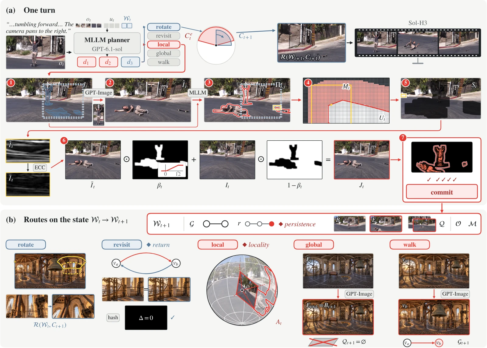
  </picture>
</p>
<p align="center"><sub><b>WM<sup>MLLM</sup> overview.</b> Pretrained models read the explicit state, and only commits that pass the checks write it.</sub></p>

The [architecture notes](docs/ARCHITECTURE.md) map these components to modules and describe turn and commit semantics.

</details>

## Run it yourself

### What this release contains

This release contains the session engine used for the paper's multi-turn sessions, API providers, CPU panorama geometry, observed semantic memory, revision-aware saved views, and the code that scores the paper's saved outputs. Procedural examples use deterministic providers that are labeled as such. They test software behavior and do not measure model quality.

The video generation model and its runtime are not included. Eligible rotations and revisits are rendered on CPU; other transitions have no video. A video model plugs in through the `VideoBackend` interface. Model weights, datasets and paper outputs are not included.

### Install

Use Linux or a compatible POSIX system with Python 3.10 or later. CPU clips require `ffmpeg` on PATH. GPU and model packages are unnecessary for core installation.

```bash
git clone https://github.com/ztMotaLee/WM_mllm.git
cd WM_mllm
python -m venv .venv
. .venv/bin/activate
python -m pip install .
```

Install `'.[dev]'` to run tests. The wheel contains the `wmmllm` package and its prompt resources. Evaluation runs from the source checkout; see [evaluation](docs/EVALUATION.md).

### Use your own API

> [!IMPORTANT]
> This repository provides no API key, account, endpoint or default model. You fill every `WMM_*` value yourself, including the base URL of your own provider, and you pay your provider for the requests.

```bash
cp .env.example .env
# Fill the WMM_* values in your own .env file.
wmmllm check-config --env-file .env
```

Keys come only from the process environment or an env file you name (`--env-file`, or `env_file` in a YAML config). The program never searches for an env file. Do not put keys in YAML or command-line arguments. `WMM_LLM_BASE_URL` and the model names are required and have no built-in default. Chat requests use the Chat Completions endpoint. See every key, precedence rule and spend cap in [configuration](docs/CONFIGURATION.md).

<details>
<summary>Models used in the paper, endpoint requirements and the message when a key is missing</summary>

<br>

Set both `WMM_LLM_MODEL` and `WMM_IMAGE_MODEL` for distinct chat and image models. An empty image field inherits the chat field of the same name.

The eight-turn session studies and the MBench-A recovery run used GPT-6.1-sol with reasoning effort **high** for all chat roles and GPT-Image 2.5 through the image edit endpoint. In the 817-segment benchmark run, 606 segments recorded an effort above high that public endpoints do not offer, 154 high, 23 medium and one max, and the 33 holds at initialization recorded none; see [evaluation](docs/EVALUATION.md). The 21-request conservatory session under [Earlier edits stay](#earlier-edits-stay) ran GPT-6.1-sol at reasoning effort xhigh with GPT-Image 2.5. The historical CompBench proposals used GPT-Image 2. Other models may behave differently. Your endpoint must support the models you select, multimodal inputs in a fixed order, strict JSON schemas, reasoning controls and multi-image editing. Endpoint compatibility and live model quality require separate verification.

Without configuration, `wmmllm check-config` exits with code 2 before constructing a client:

```text
Missing WMM_LLM_API_KEY for chat provider; set the process environment or an explicitly selected env file; no request was sent.
```

</details>

### Quickstart

First run the offline procedural example from this source checkout:

```bash
python -B examples/offline_session/run.py --run offline-run
wmmllm view --run offline-run --yaw 0 --pitch 0 --out offline-view.png
```

The program does not overwrite a run directory or an output file, so use new ones each time. The example performs initialization, rotation, a local edit drawn by the example and a revisit with real engine geometry, memory and transactions. It makes no model calls. Its providers do not implement navigation; separate core tests exercise navigation with test responses from a queue. `wmmllm view` renders the current state without credentials.

For a real session, supply your own initial image and configured API:

```bash
wmmllm init --image room.png --run my-run --title "My room" --env-file .env
wmmllm step --run my-run --env-file .env 'Look right by 45 degrees.'
wmmllm step --run my-run --env-file .env 'Put a blue bowl on the table.'
wmmllm session --run my-run --script turns.json --env-file .env
```

Each real command may incur provider charges. Supply an explicit env file again on later commands. Configure prices and a spend cap before running if needed.

<details>
<summary>Session scripts and resuming initialization</summary>

<br>

`session` resumes a session and executes an array of instruction strings or an object with a `turns` array. Each array entry may also be an object with an `instruction` string.

If initialization fails, retry the checkpoint it saved with `wmmllm resume --run my-run --env-file .env`. Use the same configuration. A hold labeled `BOOTSTRAP_HOLD` keeps the original image and leaves the world uninitialized, with no panorama or memory facts; `resume` can retry it. Repeating `init` also requires the same image pixels, captions, seed, panorama width and runtime settings. Initialization inputs that differ are rejected. Each retry keeps prior attempt files intact.

</details>

### Evaluation

The [evaluation guide](docs/EVALUATION.md) covers MBench environment scoring, saved-pose camera analysis and CompBench, and maps each paper result to its code. Obtain datasets, saved outputs, benchmark code and weights separately. CPU tests require no downloads:

```bash
python -m pytest -q
```

## Limitations

WM<sup>MLLM</sup> does not complete every request, and an error carries forward to the next request. The panorama holds the world around one camera center, so translation and unseen regions require generation. Video presentation adds minutes of latency to each request. [Section 5 of the technical report](https://arxiv.org/pdf/2611.24193#page=14) gives the details.

Historical recovery, pooled diagnostics, multi-turn sessions and CompBench used distinct configurations. Fresh generation is stochastic. Paper numbers are reproduced by scoring the original outputs, rather than by bit-identical regeneration. Original outputs and video generation are not distributed here.

The current session engine uses one full session configuration. Historical recovery profiles, study arms and independent judge pipelines are absent. Cross-origin revisits have no clip. External API access, model availability and new model behavior are user-specific. The dependency ranges are not a full transitive reproduction lock. See [architecture](docs/ARCHITECTURE.md) for state and transaction behavior.

## License

Original code and procedural assets use [Apache-2.0](LICENSE); see [NOTICE](NOTICE). The evaluation adapters load MBench and CompBench from checkouts you obtain; their code is not included. Model weights, datasets and user outputs are governed by their own terms.

## Citation

```bibtex
@article{li2026wmmllm,
  title   = {{WM$^{\mathrm{MLLM}}$}: Turning {MLLMs} into World Models},
  author  = {Li, Baiang and Xie, Enze and Yu, Jincheng and Wang, Jin and Liu, Haozhe and Li, Yitong and Tian, Juanxi and Heide, Felix},
  journal = {arXiv preprint arXiv:2611.24193},
  year    = {2026}
}
```
